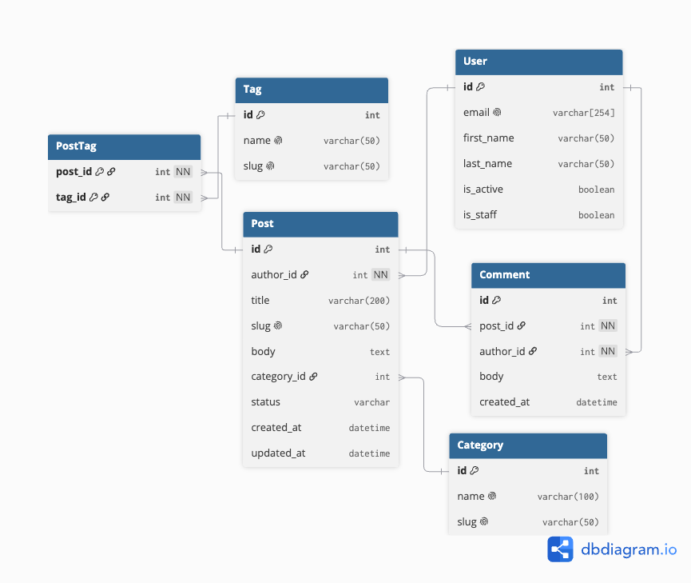
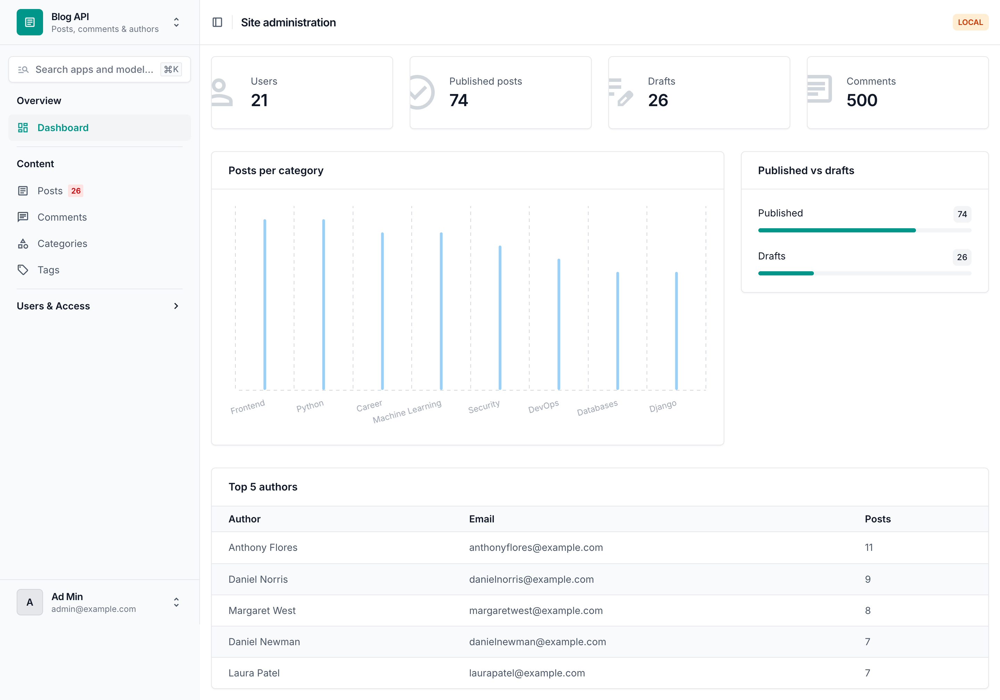
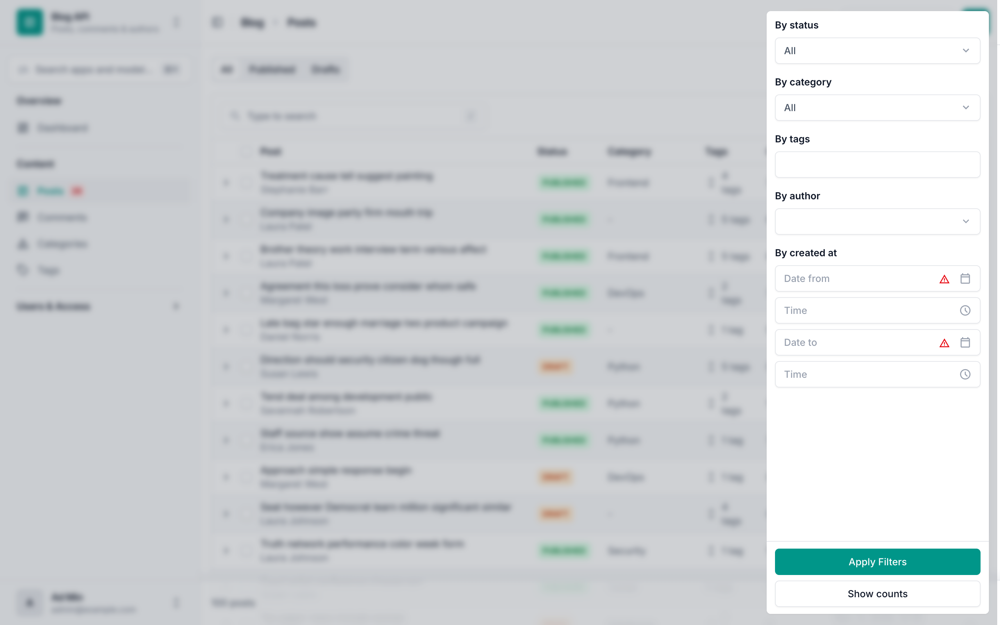
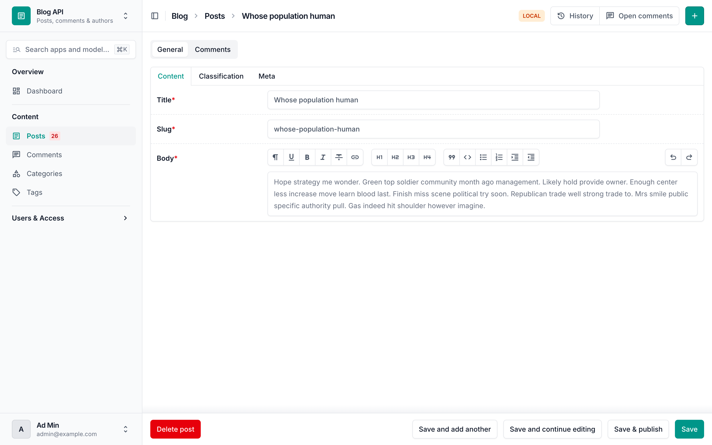
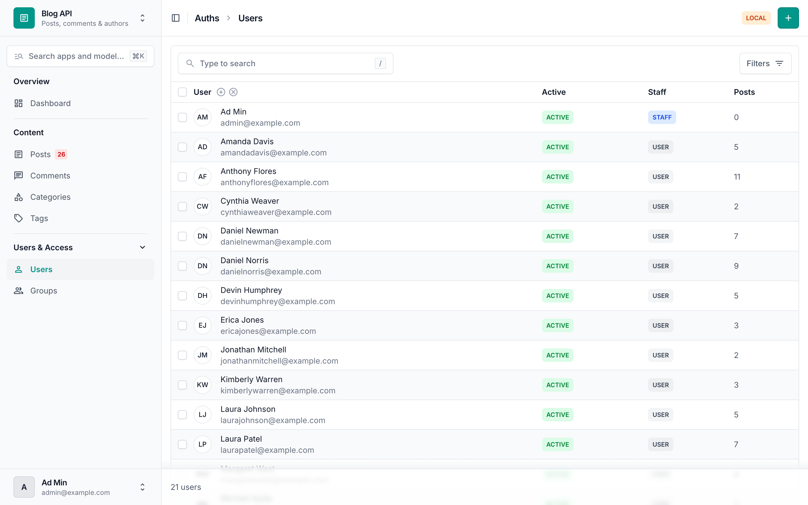

# Blog API

Blog REST API built with Django.

## ERD



## Setup

```bash
python -m venv .venv
source .venv/bin/activate
pip install -r requirements/dev.txt
```

Create `settings/.env`:

```
BLOG_ENV_ID=local
BLOG_SECRET_KEY=change-me

# prod only
BLOG_ALLOWED_HOSTS=example.com,www.example.com
BLOG_DB_NAME=blog
BLOG_DB_USER=blog
BLOG_DB_PASSWORD=secret
BLOG_DB_HOST=localhost
BLOG_DB_PORT=5432
```

Run (on an empty database this gives a working admin full of data):

```bash
python manage.py migrate
python manage.py seed
python manage.py createsuperuser
python manage.py runserver
```

Open http://127.0.0.1:8000/admin/

## Seeding

`python manage.py seed` fills **all** models with fake data (Faker):
users, categories, tags, posts and comments.

| Argument     | Default | Description                                         |
|--------------|---------|-----------------------------------------------------|
| `--users`    | `20`    | Number of users to create                           |
| `--posts`    | `100`   | Number of posts to create                           |
| `--comments` | `500`   | Number of comments to create                        |
| `--clear`    | off     | Delete existing data (except superusers) first      |

- All seeded users share the password `seedpass123`.
- ~10% of users are inactive, ~5% are staff.
- 8 categories and 20 tags with real names; existing ones are skipped.
- ~70% of posts are published, ~30% drafts; ~10% have no category; 0–5 tags each.
- Comments are added only to published posts.
- Safe to run several times in a row.

Example:

```bash
$ python manage.py seed --users 50 --posts 300 --comments 1500
Users:        50 created
Categories:    8 created
Tags:         20 created
Posts:       300 created
Comments:   1500 created
Done in 2.41 seconds

$ python manage.py seed --clear      # start over
```

## Admin

The admin uses [Django Unfold](https://unfoldadmin.com/):

- custom sidebar (Overview / Content / Users & Access — the last one for superusers only),
  drafts badge, `Cmd+K` / `Ctrl+K` search, environment badge, teal palette;
- dashboard with cards, posts-per-category chart, top authors and published/draft progress;
- posts: tabs All / Published / Drafts, dropdown & autocomplete filters, expandable rows
  with comments, row / bulk / list / detail / submit-line actions, WYSIWYG editor,
  tabbed edit form with paginated comments inline;
- users: header column with initials, colored labels, radio filters, tabbed form,
  activate / deactivate actions.

Set `BLOG_SQL_LOG=True` in `settings/.env` to log every SQL query (N+1 check).

### Dashboard


### Post list with filters


### Post edit page


### User list


Lint:

```bash
ruff check .
ruff format .
```
